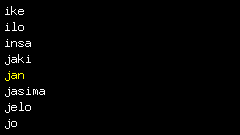
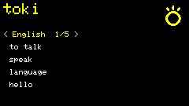

<h1 align="center">toki pona ⇄ dictionary</h1>

<p align="center">
  <strong>An offline Toki Pona ⇄ multi-language dictionary for ESP32 devices, with sitelen pona glyphs.</strong>
</p>

<p align="center">
  <a href="https://github.com/Isonimus/esp-32-toki-pona-dict/actions/workflows/ci.yml"></a>
  <a href="LICENSE"></a>
  <a href="https://creativecommons.org/licenses/by-sa/4.0/"></a>
  
</p>

<p align="center">
  <a href="#features">Features</a> •
  <a href="#hardware">Hardware</a> •
  <a href="#build-and-flash">Build &amp; flash</a> •
  <a href="#usage">Usage</a> •
  <a href="#development">Development</a> •
  <a href="#licensing">Licensing</a>
</p>

<p align="center">
  
  &nbsp;&nbsp;
  
</p>

> [!NOTE]
> **Alpha.** The dictionary core, the UI, and two boards are proven on hardware; more boards and a
> browser-based flasher are planned. Expect occasional breaking changes between releases.

---

## Features

- **Two-way, mode-free lookup.** Type in Toki Pona *or* any supported language and matches appear
  as you go — there is no "direction" to switch. Diacritics fold automatically, so `jasima` and
  `ni` and `espejo` all find the same word.
- **Six languages + display-only Chinese.** English, Spanish, French, German, Portuguese, and
  Simplified Chinese glosses for all **137 headwords** (full *nimi pu* plus *nimi ku suli*).
- **sitelen pona glyphs.** Each word shows its sitelen pona glyph, rasterized into the firmware at
  build time — no font parsing on the device.
- **Browse or search, per board.** A keyboard board types to search; a keyboard-less board browses
  the whole corpus and navigates with its buttons. One firmware image serves both.
- **Fully offline.** No Wi-Fi, no network, no companion app. The whole dictionary is compiled into
  the firmware.

## Hardware

One firmware image flashes many boards; a board is selected by a build flag. Rendering and input
sit behind a hardware abstraction layer, so adding a board is a driver plus a PlatformIO env — the
dictionary and UI never change for it.

| Board | Env | Display | Input | Status |
| --- | --- | --- | --- | --- |
| M5Cardputer (ADV) | `tp_cardputer` | 240×135 ST7789 | 56-key keyboard (TCA8418) | ✅ proven on hardware |
| M5StickC Plus2 | `tp_stickc_plus2` | 135×240 ST7789 (landscape) | 3 buttons (browse) | ✅ proven on hardware |
| M5Cardputer (original) | `tp_cardputer` | 240×135 ST7789 | 56-key keyboard (74HC138) | 🚧 keyboard scan pending |

On-device proof for each board — screenshots and an input walk-through — lives under
[`docs/bringup/`](docs/bringup/).

## Build and flash

Requires [PlatformIO](https://platformio.org/) and Node.js 22+ (Python 3.13 only if you regenerate
the glyph tables).

```sh
# Build for a board (downloads the ESP32 toolchain on first run)
pio run -e tp_cardputer
pio run -e tp_stickc_plus2

# Flash a connected board
pio run -e tp_cardputer -t upload --upload-port /dev/ttyACM0
```

A browser-based flasher (no toolchain needed) is planned for the first tagged release.

## Usage

**Keyboard board (Cardputer).** Type in any language; results list as you type. Arrow keys move the
selection, Enter opens the detail view, and in detail the arrows cycle the language shown. An empty
query shows a short type-to-search prompt.

**Button board (StickC Plus2).** With no keyboard, the empty screen *is* the whole corpus: the
front button scrolls the list (wrapping), the side button opens a word, and the power button goes
back. In the detail view the front button cycles the language. 

Each word's detail view shows one language at a time — headword, its sitelen pona glyph, and the
senses one per line — so a long gloss never overflows a small screen.

## Development

```sh
npm run test:host        # regenerate tables, compile the core with -Wall -Wextra, run the native tests
```

The host suite proves the normalization contract, symmetric diacritic-folded search, the generated
tables' freshness, the third-party-notice obligation, and the UI state machine — no hardware
needed, and it must pass before any core change. Rendering and on-device input cannot be asserted
by a host test, so each board ships a **bring-up proof** (screenshot set + input walk-through) under
[`docs/bringup/`](docs/bringup/).

The architecture, data pipeline, and every design decision are recorded in
[`adr/`](adr/). See [CONTRIBUTING.md](CONTRIBUTING.md) before opening a PR, and
[CLAUDE.md](CLAUDE.md) for the project's conventions.

## Licensing

Two licenses, kept deliberately distinct (see [ADR-0021](adr/0021-firmware-code-license-mit.md) and
[ADR-0016](adr/0016-dictionary-data-provenance-and-license.md)):

- **Code** — the firmware source (`core/`, `hal/`, `app/`, `main/`, `tools/`, `test/`) is
  [MIT](LICENSE).
- **Dictionary data** — `data/` and the generated tables are **CC BY-SA 4.0**, because the glosses
  derive from [lipu Linku](https://github.com/lipu-linku/sona)'s community dictionary under its
  ShareAlike terms. Attribution and the fonts' notices are in
  [THIRD_PARTY_NOTICES.md](THIRD_PARTY_NOTICES.md).
